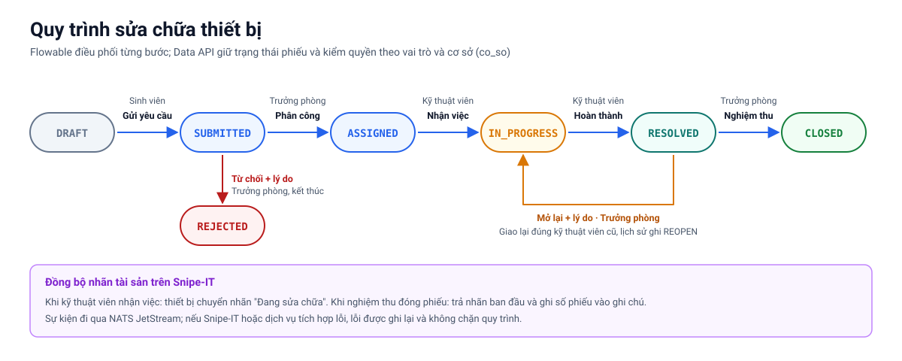

<!--
SPDX-FileCopyrightText: 2026 HaUI-Libre DX-Lab contributors
SPDX-License-Identifier: Apache-2.0
-->

# Flowable REST (issue #15)

`docker-compose.yml` chạy `flowable/flowable-rest:7.2.0` headless trên database
`flowable` do `core/postgres/init/01-create-databases.sh` tạo ở lần khởi tạo
PostgreSQL đầu tiên. Flowable tự tạo bảng engine trong database này. Service
không mở cổng ra máy host; APISIX chuyển
`GET /api/workflow/repository/process-definitions` tới
`/flowable-rest/service/repository/process-definitions` trên mạng Compose.

## Chạy và kiểm tra

1. Sao chép `.env.example` thành `.env`, thay mọi giá trị `changeme`, nhất là
   `FLOWABLE_DB_PASSWORD` và `FLOWABLE_ADMIN_PASSWORD`.
2. Chạy `make up`. Make đợi các service healthy rồi chạy `workflow-deploy`
   qua REST nội bộ. Deployer đọc nội dung process definition mới nhất; nếu BPMN
   giống hệt thì bỏ qua, nếu đổi thì tạo version mới. Mọi lần `make up` đều chạy
   deployer lại. Lỗi REST hoặc deploy khiến Make trả mã lỗi.
   Chạy `make smoke` để kiểm tra token và process definition qua gateway.
3. Có thể xem JSON trực tiếp bằng token của một tài khoản demo:

   ```bash
   curl -H "Authorization: Bearer <access-token>" \
     http://localhost:9080/api/workflow/repository/process-definitions
   ```

Sau `make up`, danh sách có process key `dxlabHelpdeskRepair`. Bộ request
[workflow-api.md](../../docs/workflow-api.md) chạy ba nhánh qua gateway.
Không bật process demo mặc định của Flowable.

## Quy trình DX-Helpdesk (#18)



Process key là `dxlabHelpdeskRepair`. Data API khởi tạo process sau khi ticket
chuyển `DRAFT → SUBMITTED`, rồi hoàn thành task tương ứng khi người dùng thao tác.
Flowable giữ process instance và task; Data API giữ trạng thái ticket và lịch sử.
Data API gọi Flowable qua APISIX (`/api/workflow`); hai bên liên kết bằng
`workflow_instance_id` và `ticket_id`.

| Biến process | Nguồn và ý nghĩa |
|---|---|
| `ticket_id` | ID ticket do Data API tạo. |
| `co_so` | Cơ sở của ticket xác định từ vị trí thiết bị hoặc vị trí người báo chọn khi không có thiết bị. |
| `manager_candidate_group` | Nhóm nội bộ `manager_<co_so>`, do Data API suy ra từ `co_so`. |
| `technician_candidate_group` | Nhóm nội bộ `technician_<co_so>`, do Data API suy ra từ `co_so`. |
| `assigned_technician` | Username kỹ thuật viên cùng cơ sở, đặt khi quản lý hoàn thành bước phân công; giữ nguyên khi mở lại. |
| `intake_action` | `ACCEPT` hoặc `REJECT`; nhánh từ chối cần `rejection_reason` không rỗng sau khi bỏ khoảng trắng. |
| `review_action` | `CLOSE` hoặc `REOPEN`; nhánh mở lại cần `reopen_reason` không rỗng sau khi bỏ khoảng trắng. |

`manager_<co_so>` và `technician_<co_so>` là candidate group **nội bộ của
quy trình**, không phải realm role mới trong Keycloak. Data API phải lấy vai trò
và `co_so` người thao tác từ token đã xác thực, kiểm tra quyền trên từng
chuyển trạng thái và chỉ cho quản lý phân công kỹ thuật viên cùng cơ sở. Không
tin biến nhóm hoặc `co_so` do giao diện gửi. Flowable REST hiện dùng một tài
khoản chung sau gateway, nên chỉ candidate group trong BPMN không thể tự bảo
đảm người dùng cơ sở khác không đọc hoặc hoàn thành task.

| Hoàn thành task | Chuyển trạng thái ticket do Data API thực hiện |
|---|---|
| Tiếp nhận, `REJECT` + lý do | `SUBMITTED → REJECTED`; ghi `REJECT`; process kết thúc. |
| Phân công | `SUBMITTED → ASSIGNED`; lưu `assigned_technician`. |
| Kỹ thuật viên tiếp nhận | `ASSIGNED → IN_PROGRESS`; yêu cầu dịch vụ tích hợp đặt nhãn tài sản “Đang sửa chữa”. |
| Xử lý xong, có biên bản | `IN_PROGRESS → RESOLVED`. |
| Nghiệm thu, `REOPEN` + lý do | `RESOLVED → IN_PROGRESS`; ghi `REOPEN`, giao lại kỹ thuật viên cũ và giữ biên bản cũ trong lịch sử. |
| Nghiệm thu, `CLOSE` | `RESOLVED → CLOSED`; process kết thúc, yêu cầu dịch vụ tích hợp khôi phục nhãn tài sản cũ. |

Không có service task gọi Snipe-IT trong BPMN. Data API là bên điều phối hai
điểm cập nhật tài sản trên qua APISIX (`/api/assets`) tới dịch vụ tích hợp; lỗi tích hợp
được ghi để thử lại và không chặn quy trình. Các gateway trong BPMN có điều
kiện bắt buộc lý do; Data API cũng phải kiểm tra và trả lỗi trước khi gọi
Flowable. Việc triển khai Data API và kiểm tra phân quyền thực tế thuộc #20,
#73, #74; tự deploy và chạy API qua gateway thuộc #19.

## Xác thực và giới hạn hiện tại

APISIX xác thực token Keycloak và vai trò trước, sau đó dùng tài khoản REST
nội bộ từ `.env` để gọi Flowable. Basic credential không nằm trong
`apisix.yaml` và không được gửi cho trình duyệt. Flowable vẫn nhìn thấy một
tài khoản REST chung; người thực hiện từng bước do Data API ghi vào
`ticket_events.actor_sub` (#20, #21), không nằm trong audit của Flowable.
Gateway mở các route chạy quy trình và history **chỉ cho `ROLE_ADMIN`** phục vụ
kiểm thử #19. Các vai trò nghiệp vụ khác cần đi qua Data API (#20), nơi kiểm tra
quyền và `co_so` trước khi hoàn thành task; bộ request admin chỉ chứng minh BPMN
và REST, chưa chứng minh đồng bộ trạng thái ticket hay phân quyền nghiệp vụ.

Nếu PostgreSQL volume đã tồn tại trước khi database `flowable` được thêm vào
script khởi tạo, script sẽ không tự chạy lại. Kiểm tra/tạo database và user
trong volume hiện có; tránh `docker compose down -v` vì lệnh đó xóa dữ liệu.
