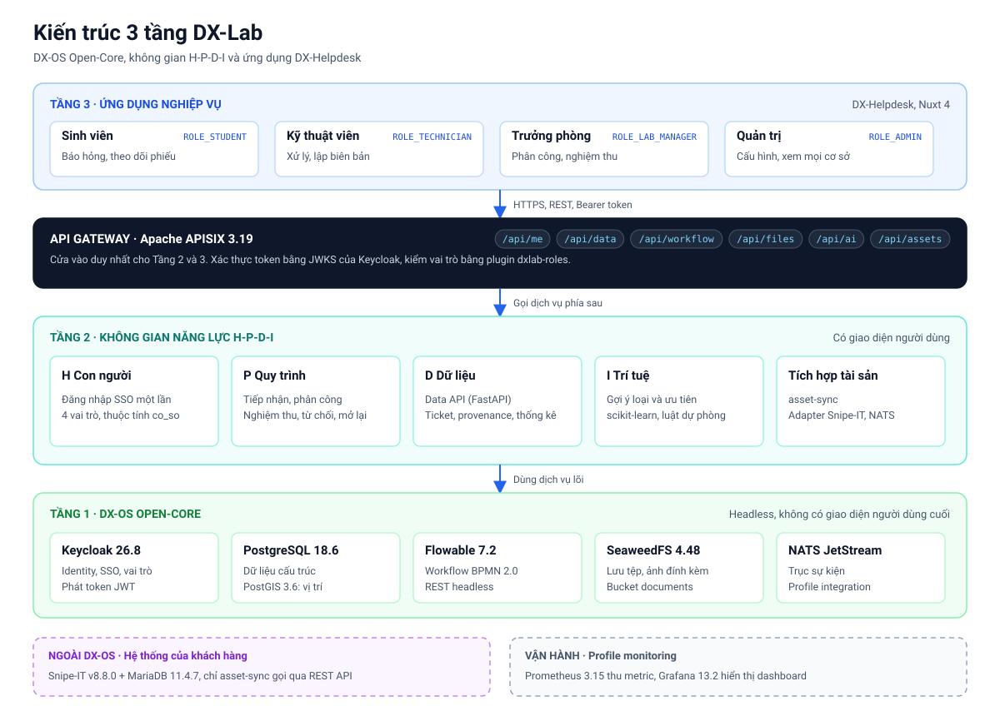
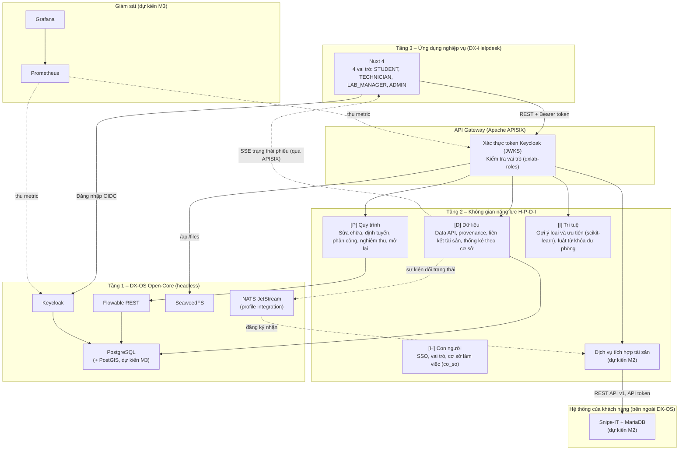
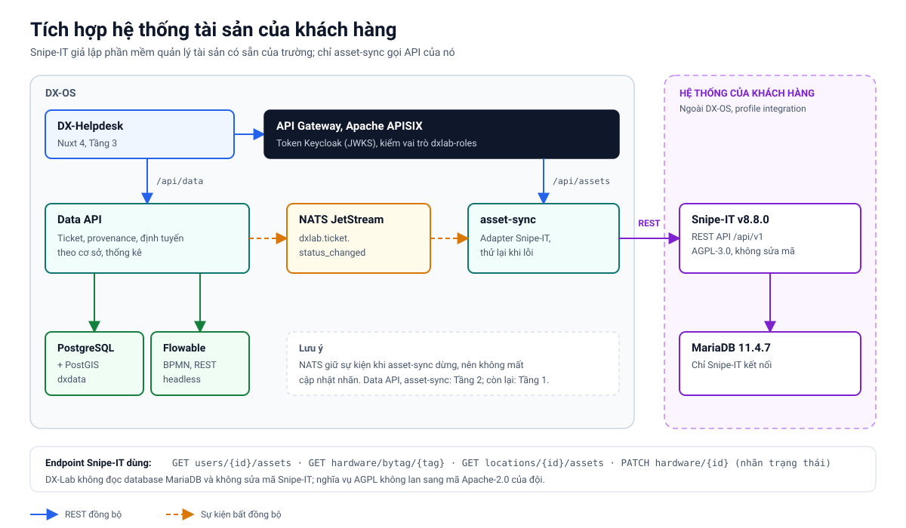
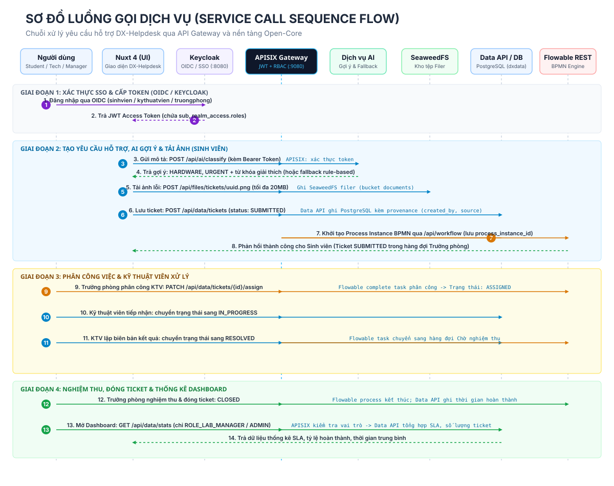
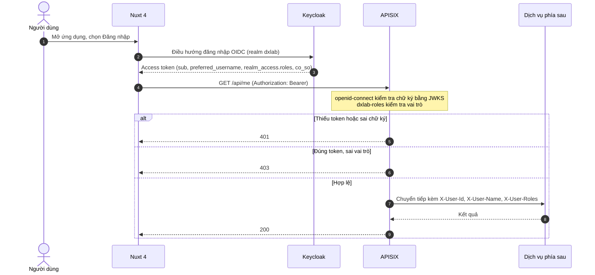
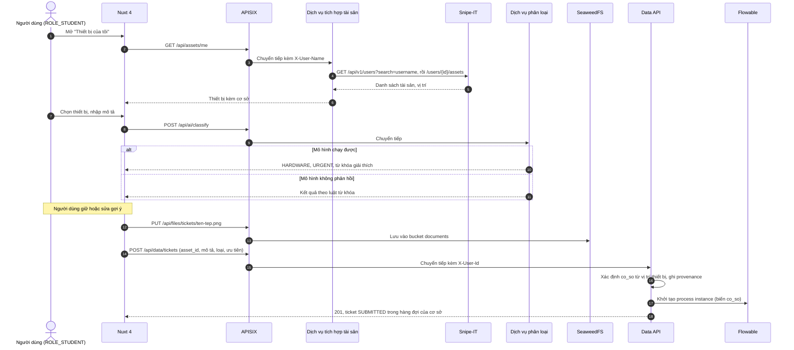
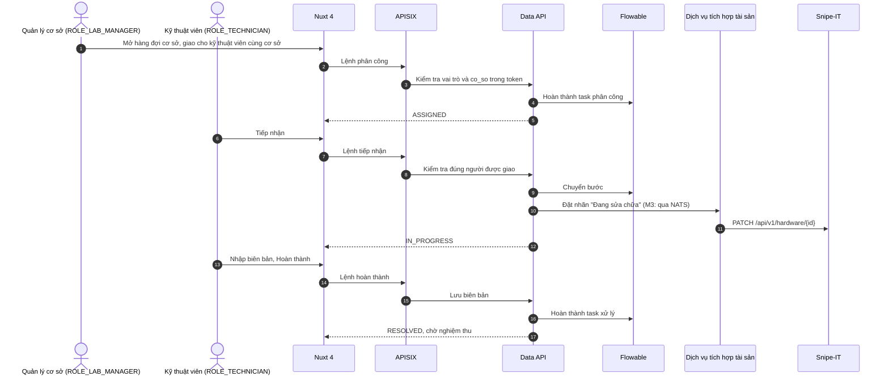
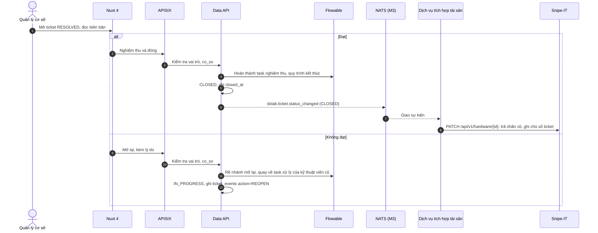
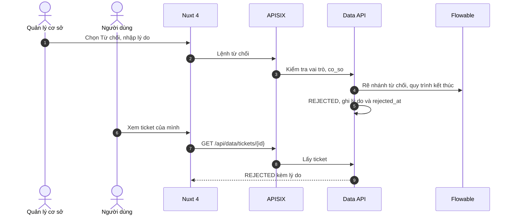

<!--
SPDX-FileCopyrightText: 2026 HaUI-Libre DX-Lab contributors
SPDX-License-Identifier: Apache-2.0
-->

# Kiến trúc DX-Lab và luồng gọi dịch vụ

Tài liệu mô tả kiến trúc 3 tầng, không gian H-P-D-I, cách DX-Lab tích hợp với hệ thống
quản lý tài sản CNTT của khách hàng, ranh giới mạng, các luồng gọi dịch vụ và các
quyết định kiến trúc. Ứng dụng minh họa là **DX-Helpdesk**: báo hỏng và sửa chữa thiết
bị CNTT, định tuyến theo cơ sở, cập nhật trạng thái về hệ thống tài sản. Nghiệp vụ chi
tiết: [usecases.md](usecases.md).

Ký hiệu: _(dự kiến Mx)_ là phần chưa triển khai, sẽ làm ở milestone đó. Mục 8 ghi trạng
thái thực tế của từng thành phần.

## 1. Kiến trúc tổng thể 3 tầng

### Tầng 3 – Ứng dụng nghiệp vụ

- **DX-Helpdesk**, viết bằng Nuxt 4.5.2 (`app/`).
- Không kết nối trực tiếp tới PostgreSQL, Flowable, SeaweedFS, NATS, dịch vụ AI hay
  Snipe-IT. Mọi lời gọi đi qua APISIX với token Keycloak.

### Tầng 2 – Không gian H-P-D-I

| Không gian | Chức năng | Thành phần | Dịch vụ Tầng 1 dùng |
|---|---|---|---|
| H – Con người | SSO, 4 vai trò, thuộc tính `co_so` | Client OIDC trong Nuxt, Portal tối giản | Keycloak |
| P – Quy trình | Quy trình sửa chữa, định tuyến theo cơ sở, phân công, nghiệm thu, mở lại, lịch sử | BPMN 2.0 | Flowable |
| D – Dữ liệu | Ticket, provenance, liên kết tài sản, thống kê theo cơ sở | Data API (FastAPI) | PostgreSQL (`dxdata`), PostGIS _(M3)_ |
| I – Trí tuệ | Gợi ý loại và mức ưu tiên có giải thích, luật từ khóa dự phòng | Dịch vụ phân loại (FastAPI, scikit-learn) | Không cần dịch vụ riêng |

Dịch vụ tích hợp tài sản cũng nằm ở Tầng 2. Nó là lớp logic tích hợp giữa DX-OS và hệ
thống của khách hàng, không thuộc không gian nào trong H-P-D-I nhưng phục vụ cả P và D.

### Tầng 1 – DX-OS Open-Core

Headless, không có UI người dùng cuối:

1. **Apache APISIX 3.19.0:** cửa ngõ duy nhất cho API.
2. **Keycloak 26.8.0:** SSO, vai trò, thuộc tính người dùng.
3. **PostgreSQL 18.6:** database riêng cho `keycloak`, `flowable`, `dxdata`. PostGIS 3.6.4
   bật trên `dxdata` (#76); định tuyến theo vùng dùng nó ở M3 (#79).
4. **Flowable REST 7.2.0:** chạy quy trình BPMN.
5. **SeaweedFS 4.48:** ảnh và biên bản đính kèm.
6. **NATS JetStream 2.15.1** (profile `integration`, #77): trục sự kiện tích hợp.

## 2. Bảng ánh xạ 7 lớp công nghệ

Đề OLP PMNM 2026 chia công nghệ thành 7 lớp và gợi ý một stack tham khảo cho mỗi lớp
([đề thi](https://www.vfossa.vn/tin-tuc/de-thi-phan-mem-nguon-mo-olp-2026-798.html)).
Bảng tham chiếu trong đề là ví dụ, đội tự chọn công nghệ. Bảng dưới ánh xạ từng lớp vào 3 tầng
của DX-Lab.

| Lớp (theo đề) | Thành phần DX-Lab | Tầng | Trạng thái |
|---|---|---|---|
| 1. Trải nghiệm & Giao diện Đa kênh | Nuxt 4 (DX-Helpdesk, Portal tối giản) | 3, 2 | Đăng nhập SSO (#24), báo hỏng, hàng đợi, chi tiết và các bước quy trình (#26) đã chạy |
| 2. Biên mạng, Cửa ngõ & An toàn thông tin | APISIX (gateway, JWKS, `dxlab-roles`), Keycloak (SSO, vai trò, `co_so`), cổng chỉ mở trên `127.0.0.1`, gitleaks | 1 | Đã chạy |
| 3. Tác nghiệp, Logic & Trạng thái Thực thể | Data API (FastAPI), PostgreSQL, dịch vụ tích hợp tài sản (logic tích hợp với Snipe-IT) | 2, 1 | Data API đã chạy (CRUD, luồng Flowable, provenance, tệp đính kèm); dịch vụ tích hợp tài sản chưa có (#72) |
| 4. Tự động hóa, Quy trình & DevSecOps | Flowable (BPMN), GitHub Actions (`reuse lint`, gitleaks, kiểm tra tiêu đề PR, dựng stack từ volume trống), Docker Compose (profile) | 1 | Đã chạy: BPMN tự deploy (#18, #19), CI dựng stack sạch (#90) |
| 5. Dữ liệu Siêu hội tụ, Truyền phát & Sổ cái | NATS JetStream (truyền phát sự kiện), bảng `ticket_events` (sổ lịch sử thay đổi), SeaweedFS (dữ liệu phi cấu trúc) | 1, 2 | SeaweedFS đã chạy; NATS dự kiến M3 |
| 6. Phục vụ Phân tích, Không gian & Trí tuệ | PostGIS (định tuyến theo cơ sở), API thống kê và dashboard theo cơ sở, scikit-learn (phân loại), Leaflet (bản đồ, tùy chọn) | 1, 2 | PostGIS bật trên `dxdata` (#76), định tuyến bằng bảng vị trí đã chạy (#73); định tuyến theo vùng (#79), API thống kê (#22), dịch vụ phân loại (#28, #31) chưa xong; trang thống kê đã có (#27) |
| 7. Quản trị, Tìm kiếm & Giám sát Hệ thống | Prometheus, Grafana, tìm kiếm ticket theo chữ trong PostgreSQL | Ngoài 3 tầng (vận hành) | Prometheus, Grafana đã chạy trong profile `monitoring` (#78); tìm ticket theo tiêu đề, mô tả bằng `GET /tickets?q=` (`ILIKE`, chưa dùng full-text) |

Những thành phần trong bảng tham khảo mà đội chọn không dùng, ưu tiên thành phần có giấy phép
OSI để thống nhất và phù hợp mục tiêu chủ quyền số (nguồn kiểm tra: [license-decision.md](license-decision.md)):

| Lớp | Gợi ý của đề | Giấy phép | DX-Lab dùng |
|---|---|---|---|
| 2 | HashiCorp Vault | BUSL-1.1 | Secret trong `.env`, không commit |
| 3 | MongoDB | SSPL-1.0 | PostgreSQL |
| 4 | n8n | Sustainable Use License | Flowable |
| 5 | Redpanda | BSL 1.1 | NATS |
| 5 | ImmuDB | BUSL-1.1 | Bảng `ticket_events` trong PostgreSQL |

## 3. Tích hợp với hệ thống tài sản của khách hàng

### 3.1. Bối cảnh

Đơn vị đã có phần mềm quản lý tài sản CNTT. DX-Lab không thay thế nó mà tích hợp vào:
đọc danh mục tài sản và vị trí, ghi trạng thái sửa chữa ngược lại. Trong bài thi, hệ
thống của khách hàng được giả lập bằng Snipe-IT v8.8.0 (AGPL-3.0) với MariaDB 11.4.7
(GPL-2.0), theo compose chính thức của Snipe-IT.

### 3.2. Ranh giới

- Snipe-IT và MariaDB chạy trong profile `integration`, là **hệ thống bên ngoài DX-OS**,
  không thuộc Tầng 1. Đổi sang phần mềm tài sản khác chỉ phải viết lại bộ chuyển đổi
  trong dịch vụ tích hợp.
- Chỉ dịch vụ tích hợp tài sản gọi Snipe-IT, qua REST API `/api/v1` với API token của
  một tài khoản dịch vụ. Token để trong `.env`.
- Giao diện gọi `GET /api/assets/me` và các route `/api/assets/*` qua APISIX;
  dịch vụ `asset-sync` trong profile `integration` là nơi duy nhất gọi Snipe-IT.
- Không đọc database MariaDB của Snipe-IT và không sửa mã Snipe-IT. Vì vậy nghĩa vụ
  AGPL không lan sang mã Apache-2.0 của đội.

### 3.3. Ánh xạ dữ liệu

| DX-Lab | Snipe-IT | Ghi chú |
|---|---|---|
| Người dùng Keycloak (`preferred_username`) | User (`username`) | Dữ liệu mẫu dùng cùng username ở hai bên |
| `asset_id` của ticket | Asset (`id`, `asset_tag`) | Schema đã dùng ID số; asset tag cũ giữ trong bảng đối soát |
| `co_so` của ticket | Location cấp cao nhất (cơ sở) | Cây vị trí: cơ sở, tòa, phòng |
| Trạng thái ticket | Status label | Ánh xạ cấu hình được; lưu nhãn trước khi sửa để trả lại khi đóng |

Endpoint Snipe-IT dùng (đã đối chiếu `routes/api.php` tại v8.8.0):

| Mục đích | Endpoint |
|---|---|
| Thiết bị đang giao cho người dùng | `GET /api/v1/users/{id}/assets` |
| Tìm thiết bị theo mã dán trên máy | `GET /api/v1/hardware/bytag/{tag}` |
| Thiết bị trong một phòng | `GET /api/v1/locations/{id}/assets` |
| Đổi nhãn trạng thái, ghi chú | `PATCH /api/v1/hardware/{id}` |
| Danh sách nhãn trạng thái, vị trí | `GET /api/v1/statuslabels`, `GET /api/v1/locations` |

### 3.4. Ghi trạng thái về Snipe-IT

- **M2, đồng bộ trực tiếp.** Khi ticket sang `IN_PROGRESS` hoặc `CLOSED`, Data API ghi
  sự kiện chờ cập nhật rồi gọi `asset-sync` qua APISIX. Dịch vụ lưu nhãn tài sản ban
  đầu trong volume riêng, trả lại khi đóng và thử lại lỗi. Kết quả thành công/thất bại
  được ghi trong `ticket_events`; lỗi không chặn quy trình. Profile `integration` phải
  bật để thực sự gọi Snipe-IT.
- **M3, qua NATS (#77, đã chạy).** Data API phát sự kiện `dxlab.ticket.status_changed`
  lên stream `DXLAB_TICKETS` của NATS JetStream sau khi commit PostgreSQL, với
  `Nats-Msg-Id` theo ticket, trạng thái và thời điểm để JetStream bỏ bản trùng. Với
  `IN_PROGRESS` và `CLOSED`, Data API ghi `ASSET_STATUS_UPDATE_QUEUED`. `asset-sync`
  đọc bằng durable consumer `asset-sync`, nên sự kiện phát lúc dịch vụ dừng vẫn được
  giao khi bật lại; xử lý lặp lại không gây sai theo `ticket_id` và `to_status`, lỗi
  Snipe-IT đi vào cơ chế thử lại sẵn có. Không kết nối được NATS (profile `integration`
  tắt) thì Data API chờ tối đa 3 giây, bỏ qua bus trong 30 giây và quay về lời gọi
  trực tiếp ở trên.
- **Cập nhật thời gian thực cho giao diện.** `GET /api/data/events/stream` (SSE) đăng ký
  thường (không durable) trên `dxlab.ticket.status_changed` và lọc từng sự kiện bằng
  cùng quy tắc hiển thị với `GET /tickets/{id}`: sinh viên chỉ nhận phiếu mình tạo,
  kỹ thuật viên nhận phiếu được giao, trưởng phòng nhận cơ sở mình theo claim `co_so`.
  Trình duyệt kết nối qua `/gw` của server Nuxt để gắn token; stream tự đóng khi token
  hết hạn và trang nối lại, nạp lại dữ liệu. Data API trả `X-Accel-Buffering: no` để
  APISIX không gom dữ liệu, và gửi dòng ping mỗi 15 giây trong giới hạn đọc 60 giây của
  gateway. Profile `integration` tắt thì endpoint trả 503, trang vẫn chạy và hiện
  "Mất kết nối cập nhật".

## 4. Định tuyến ticket theo cơ sở

Cơ sở của ticket quyết định hàng đợi và người được giao.

1. **Xác định cơ sở.** Lấy từ vị trí của thiết bị trên Snipe-IT.
   - M2: bảng ánh xạ `location_id` sang `co_so` trong `dxdata`.
   - M3: truy vấn không gian PostGIS. Mỗi cơ sở có vùng (polygon); vị trí phòng hoặc tọa
     độ người báo gửi kèm được đối chiếu bằng `ST_Contains`, không khớp vùng nào thì lấy
     cơ sở gần nhất bằng `ST_Distance`.
2. **Hàng đợi.** Quản lý và kỹ thuật viên có claim `co_so` trong token (user attribute
   Keycloak, mục 2.1 của [usecases.md](usecases.md)). Data API chỉ trả ticket có
   `co_so` trùng claim.
3. **Phân công.** Quy trình BPMN đặt candidate group theo cơ sở; quản lý chỉ chọn được
   kỹ thuật viên cùng cơ sở. Kiểm tra ở Data API, không chỉ ẩn trên giao diện.

## 5. Ranh giới mạng và profile Compose

### 5.1. Profile

| Profile | Service | Lệnh |
|---|---|---|
| mặc định (`core`) | postgres, keycloak, apisix, flowable, seaweedfs; Data API, dịch vụ phân loại, Nuxt khi có | `make up` |
| `integration` _(dự kiến M2–M3)_ | snipeit, mariadb, dịch vụ tích hợp tài sản; nats _(M3)_ | `docker compose --profile integration up` |
| `monitoring` | prometheus, grafana, postgres-exporter, nats-exporter (#78) | `make demo` |
| `setup` | workflow-deploy (chạy một lần, deploy BPMN) | `make up`, `make demo` gọi bằng `docker compose run` |
| tất cả | mọi profile | `make demo` |

Service trong profile mặc định không phụ thuộc service của profile khác, để `make up`
chạy nhẹ trên máy giám khảo. `make down` và `make ps` liệt kê mọi profile để không sót
container của profile đang bật. Khi profile `integration` tắt, "Thiết bị của tôi" báo
không kết nối được hệ thống tài sản và người dùng vẫn báo hỏng được bằng cách nhập vị
trí tay.

### 5.2. Cổng

| Service | Cổng trên máy | Ghi chú |
|---|---|---|
| apisix | `127.0.0.1:9080` | Cửa vào duy nhất cho API |
| keycloak | `127.0.0.1:8080` | Đăng nhập OIDC, trang quản trị |
| postgres | `127.0.0.1:5432` | Chỉ để phát triển (`make psql`) |
| snipeit _(M2)_ | `127.0.0.1:8081` (dự kiến) | Giao diện của hệ thống khách hàng, để demo thấy trạng thái được cập nhật |
| grafana | `127.0.0.1:3001` | Dashboard giám sát (3000 là cổng của ứng dụng) |
| flowable, seaweedfs, nats, mariadb, prometheus, Data API, dịch vụ tích hợp, dịch vụ phân loại | Không mở | Chỉ gọi trong mạng Docker |

Mọi cổng mở ra máy chỉ bind trên `127.0.0.1`.

### 5.3. Giám sát

| Nguồn metric | Cách lấy | Giấy phép |
|---|---|---|
| APISIX | Plugin `prometheus` của APISIX | Apache-2.0 |
| Keycloak | Endpoint metrics trên cổng quản trị 9000 khi bật `KC_METRICS_ENABLED` | Apache-2.0 |
| PostgreSQL | `postgres_exporter` v0.20.1 | Apache-2.0 |
| NATS | `prometheus-nats-exporter` v0.20.2 | Apache-2.0 |
| Data API, dịch vụ tích hợp | Thư viện `prometheus_client` (Python) v0.26.0 | Apache-2.0 |
| Flowable | Không thu: `flowable-rest:7.2.0` trả 404 ở `/actuator/prometheus` (chỉ có JSON Micrometer); số liệu quy trình lấy từ Data API | Apache-2.0 |

Grafana (AGPL-3.0) chạy như dịch vụ riêng; dashboard của đội là tệp JSON nạp qua
provisioning, không sửa mã Grafana. Cấu hình và kết quả kiểm tra: `core/monitoring/README.md`.

## 6. Các luồng gọi dịch vụ

### 6.1. Xác thực SSO và phân quyền ở gateway

"Nuxt 4" ở đây là phần server của ứng dụng (mô hình BFF): server Nuxt đổi code lấy
token và giữ token, trình duyệt chỉ có cookie phiên httpOnly và gọi `/gw/api/**` trên
app; server gắn Bearer token rồi chuyển sang APISIX. Chi tiết: `app/README.md`.

### 6.2. Xem thiết bị của tôi và báo hỏng _(báo hỏng đã chạy; thiết bị của tôi chờ #72)_

### 6.3. Phân công, xử lý, cập nhật Snipe-IT _(phân công, xử lý đã chạy; cập nhật Snipe-IT chờ #71, #72)_

### 6.4. Nghiệm thu, mở lại, đóng

Khi profile `integration` tắt hoặc NATS không phản hồi, mũi tên qua NATS được thay bằng
lời gọi trực tiếp từ Data API tới dịch vụ tích hợp (mục 3.4).

### 6.5. Từ chối ở bước tiếp nhận

## 7. Hợp đồng API qua gateway

Route cấu hình trong `core/gateway/apisix.yaml`.

| Route | Vai trò được phép | Upstream | Trạng thái |
|---|---|---|---|
| `GET /api/me` | Cả 4 vai trò | Sinh từ token | Đã chạy |
| `GET /api/data/stats*` | `ROLE_LAB_MANAGER`, `ROLE_ADMIN` | `data-api:8000` | Route đã có; thống kê dự kiến #22 |
| `/api/data/tickets*` | Cả 4 vai trò, Data API kiểm tra thêm chủ sở hữu và `co_so` | `data-api:8000` | CRUD và hành động workflow (#20); lịch sử, provenance và đánh giá (#21); tệp đính kèm (#26) |
| `GET /api/data/locations` | Cả 4 vai trò | `data-api:8000` | Danh mục vị trí cho form báo hỏng (#26) |
| `GET /api/data/technicians` | `ROLE_LAB_MANAGER` (cơ sở của mình), `ROLE_ADMIN` | `data-api:8000` | Kỹ thuật viên cùng cơ sở để phân công (#26) |
| `/api/workflow/data/*` | Bearer token và khóa nội bộ Data API | `flowable:8080` | Chỉ Data API gọi để tạo process/hoàn tất task |
| `GET /api/workflow/repository/process-definitions` | Cả 4 vai trò | `flowable:8080` | Đã chạy |
| `/api/files/*` | Theo đường dẫn (`core/gateway/README.md`) | `seaweedfs:8888` | Đã chạy; quyền theo thư mục từ #95 |
| `POST /api/ai/*` | Cả 4 vai trò | `ai:8000` | Route đã có; dịch vụ dự kiến M3 |
| `/api/assets/*` | Cả 4 vai trò; route `/internal/*` cần thêm khóa Data API | `asset-sync:8000` trong profile `integration` | Đọc thiết bị, tra mã/vị trí, đổi nhãn và retry (#72) |

Hợp đồng Data API: [data/openapi.yaml](../data/openapi.yaml). Schema dùng
`asset_id`, `location_id`, `co_so`; bảng `site_locations` ánh xạ 20 vị trí mẫu
Snipe-IT sang CS1/CS2/CS3. Migration giữ asset tag cũ trong bảng lưu trữ
`ticket_legacy_asset_refs` vì bộ seed cũ không có Snipe-IT ID số. Khi tích hợp
tài sản chạy, bước gửi ticket cần đối chiếu vị trí thật qua API tài sản; hiện
Data API chỉ suy ra `co_so` từ `location_id` đã nhận.

## 8. Trạng thái triển khai

| Thành phần | Trạng thái hiện tại | Kế hoạch |
|---|---|---|
| PostgreSQL 18.6 + PostGIS 3.6.4 | Đã chạy; 3 database riêng, healthcheck; extension `postgis` trên `dxdata` | M3: vùng 3 cơ sở và `ST_Contains`/`ST_Distance` (#79) |
| Keycloak 26.8.0 | Realm cấu hình 4 vai trò, 10 tài khoản demo với UUID cố định và mapper `co_so`; đã kiểm chứng import trên volume trống, `make smoke` đạt với cả 10 token | Data API dùng claim `co_so` để lọc hàng đợi |
| APISIX 3.19.0 | Đã chạy; JWKS, `dxlab-roles`, quyền theo đường dẫn trong `/api/files` (#95), route nội bộ cho Data API gọi Flowable; có route `/api/assets` trong profile `integration` | M3: plugin `prometheus` |
| Flowable REST 7.2.0 | Đã chạy; BPMN tự deploy khi `make up`; Data API chạy đủ vòng đời qua gateway, kiểm tra trong `make smoke` và CI (#98, #101) | |
| SeaweedFS 4.48 | Đã chạy; bucket `documents`; ảnh ticket dưới `tickets/<ticket_id>/` (#104, #105) | |
| Data API | Có CRUD bản nháp, luồng Flowable, `asset_id`, `co_so`, lịch sử/provenance, audit kết quả cập nhật tài sản, tệp đính kèm, `/locations`, `/technicians`; kiểm chứng trên stack sạch trong `make smoke` và CI | M2: nối dịch vụ tài sản #72; M3: thống kê theo cơ sở |
| Dịch vụ tích hợp tài sản | Có adapter REST, API qua gateway và lưu nhãn/retry trong profile `integration`; chưa xác minh end-to-end khi không có Docker daemon | M3: nhận sự kiện NATS |
| Snipe-IT + MariaDB | Có trong profile `integration`, dữ liệu mẫu 3 cơ sở (#71) | Kiểm chứng chuỗi demo với asset-sync |
| NATS 2.15.1 | Đã chạy trong profile `integration`: JetStream, stream `DXLAB_TICKETS`, consumer `asset-sync`; `make smoke-assets` thử đóng ticket lúc `asset-sync` dừng (#77) | M3: metric qua `prometheus-nats-exporter` (#78) |
| Dịch vụ phân loại | Có đặc tả | M3: scikit-learn, luật dự phòng, huấn luyện lúc build |
| Nuxt 4.5.2 | Đã chạy: đăng nhập SSO (BFF), Portal (#25), báo hỏng kèm ảnh, hàng đợi theo vai trò và cơ sở, chi tiết có lịch sử và các bước quy trình (#26) | Thiết bị của tôi hiện dữ liệu khi #72 có `/api/assets`; M3: dashboard theo cơ sở |
| Prometheus 3.15.0 + Grafana 13.2.4 | Đã chạy trong profile `monitoring`: 7 target (APISIX, Keycloak, PostgreSQL, Data API, asset-sync, NATS, Prometheus), dashboard nạp qua provisioning; `make smoke-monitoring` (#78) | |
| Bản đồ Leaflet | Chưa có | Tùy chọn ở v1.0.0 |

## 9. Chuẩn mở

Các thành phần nói chuyện với nhau qua chuẩn mở, nên thay một thành phần (ví dụ
Keycloak bằng IdP OIDC khác, Snipe-IT bằng phần mềm tài sản khác) không phải sửa các
tầng còn lại.

| Chuẩn | Bên cung cấp | Bên dùng | Tệp |
|---|---|---|---|
| OpenID Connect 1.0, OAuth 2.0 (authorization code + PKCE, client credentials) | Keycloak | Nuxt (BFF), APISIX (JWKS), Data API, `asset-sync` | `core/identity/realm-dxlab.json` |
| BPMN 2.0 | Mô hình của đội | Flowable REST | `core/workflow/helpdesk.bpmn20.xml` |
| OpenAPI 3.0 | Data API | Nuxt, người tích hợp | `data/openapi.yaml`, Swagger `/api/data/docs` |
| GeoJSON (RFC 7946) | Dữ liệu mẫu 3 cơ sở | PostGIS (#79), bản đồ (#80) | `data/samples/campuses.json` |
| Prometheus exposition format | APISIX, Keycloak, Data API, `asset-sync`, exporter | Prometheus, Grafana | `core/monitoring/prometheus.yml` |
| SPDX, REUSE 3.3 | Mọi tệp trong repo | `reuse lint` trong CI | `LICENSES/`, header từng tệp |

## 10. Quyết định kiến trúc

### ADR-01: Tầng 1 Open-Core hoàn toàn headless

- **Quyết định:** Tầng 1 (Keycloak, APISIX, PostgreSQL, Flowable, SeaweedFS, NATS) không
  có giao diện người dùng cuối. Giao diện nằm ở Tầng 2/3.
- **Lý do:** thêm hay đổi ứng dụng nghiệp vụ chỉ cần viết lại Tầng 3 và gọi dịch vụ lõi,
  không sửa Open-Core.

### ADR-02: Một cửa ngõ APISIX, xác thực bằng JWKS của Keycloak

- **Quyết định:** chỉ mở APISIX và Keycloak ra máy. APISIX chạy standalone, không cần
  etcd hay Admin API. Plugin `openid-connect` kiểm tra chữ ký token bằng JWKS tại chỗ,
  không gọi introspect cho mỗi request. Plugin `dxlab-roles` của đội trả 403 khi sai vai
  trò và chuyển header định danh xuống dịch vụ phía sau.
- **Lý do:** một điểm kiểm soát cho mọi dịch vụ nội bộ, độ trễ thấp, ít thành phần phải
  vận hành.

### ADR-03: Flowable giữ quy trình, Data API giữ dữ liệu nghiệp vụ

- **Quyết định:** Flowable quản lý process instance và task. Data API lưu ticket trong
  `dxdata`, liên kết qua `workflow_instance_id`.
- **Lý do:** Flowable hợp với điều phối quy trình; PostgreSQL hợp với lọc, thống kê và
  lưu lịch sử lâu dài.

### ADR-04: Tệp đính kèm qua SeaweedFS, không lưu trong database

- **Quyết định:** tệp đi qua `/api/files`, database chỉ lưu đường dẫn. Gateway giới hạn
  20 MB, chặn lệnh quản trị của filer, thêm `X-Content-Type-Options: nosniff` và
  `Content-Security-Policy: sandbox` khi tải về.
- **Lý do:** giữ database gọn và chặn thực thi mã qua tệp người dùng tải lên.

### ADR-05: AI chỉ gợi ý, có luật dự phòng

- **Quyết định:** dịch vụ phân loại dùng scikit-learn, trả gợi ý kèm từ khóa giải thích.
  Người dùng xác nhận hoặc sửa; mức ưu tiên cuối cùng do quản lý chốt. Khi mô hình
  không phản hồi, dùng luật từ khóa. AI không chuyển trạng thái quy trình. Không dùng
  LLM; RAG đã bỏ khỏi phạm vi.
- **Lý do:** demo không phụ thuộc máy mạnh; mọi quyết định có người chịu trách nhiệm.

### ADR-06: Tích hợp hệ thống của khách hàng qua dịch vụ trung gian

- **Quyết định:** chỉ dịch vụ tích hợp tài sản gọi Snipe-IT, qua REST API. Không đọc
  database của Snipe-IT, không sửa mã Snipe-IT. Snipe-IT và MariaDB chạy như dịch vụ
  riêng, ngoài Tầng 1.
- **Lý do:** đổi phần mềm tài sản của khách hàng chỉ phải viết lại bộ chuyển đổi; ranh
  giới giấy phép AGPL rõ ràng.

### ADR-07: NATS JetStream làm trục sự kiện

- **Quyết định:** từ M3, thay đổi trạng thái ticket phát thành sự kiện trên NATS
  JetStream; dịch vụ tích hợp đăng ký nhận (#77). Lời gọi trực tiếp của M2 giữ làm
  đường dự phòng khi NATS không chạy.
- **Lý do:** Data API không phụ thuộc Snipe-IT có đang chạy hay không. NATS dùng
  Apache-2.0; Redpanda dùng BSL 1.1.

### ADR-08: Định tuyến theo cơ sở làm hai bước

- **Quyết định:** M2 dùng bảng ánh xạ vị trí sang cơ sở; M3 thay bằng truy vấn PostGIS.
  Cơ sở của người xử lý là user attribute `co_so` trong Keycloak, không thêm vai trò.
- **Lý do:** chuỗi demo chạy được từ M2; PostGIS thêm khả năng định tuyến theo tọa độ mà
  không đổi giao diện hay quy trình. Giữ 4 vai trò như đặc tả.

### ADR-09: Chia Compose theo profile

- **Quyết định:** profile mặc định chỉ có lõi và dịch vụ của đội; `integration` và
  `monitoring` bật khi cần; `make demo` bật tất cả.
- **Lý do:** `make up` chạy được trên máy cấu hình vừa phải; phần tích hợp và giám sát
  vẫn chạy đầy đủ khi demo.
