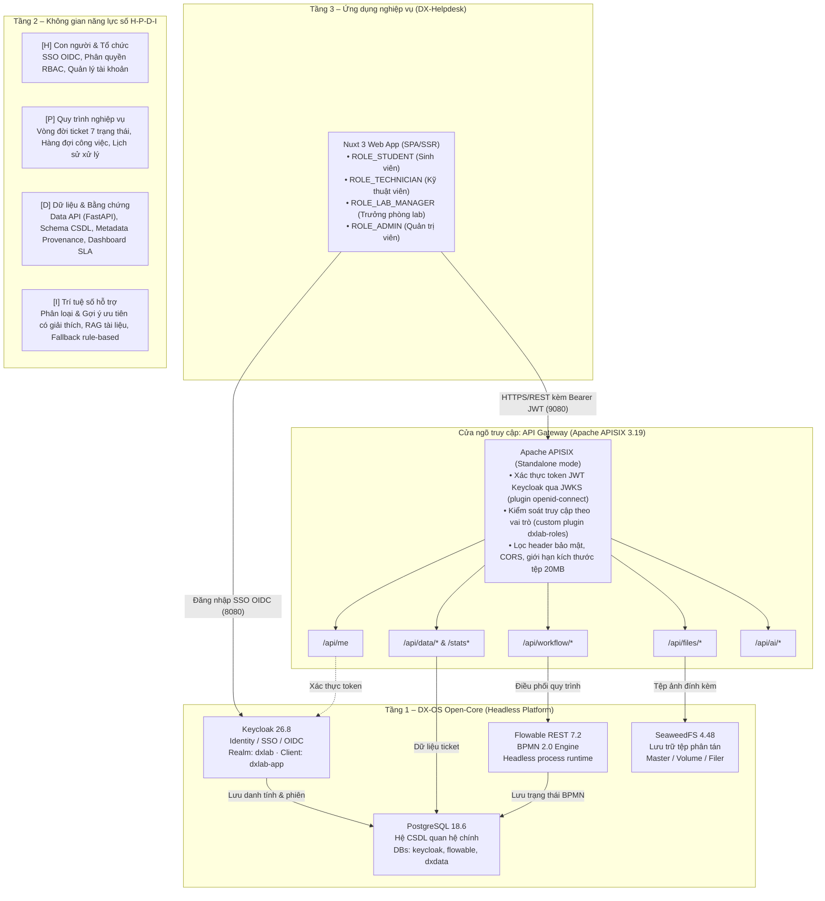
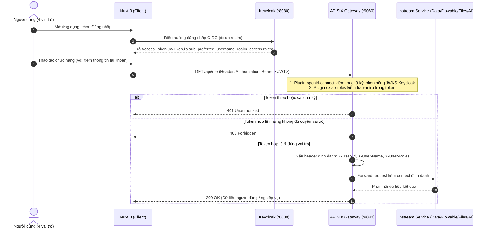
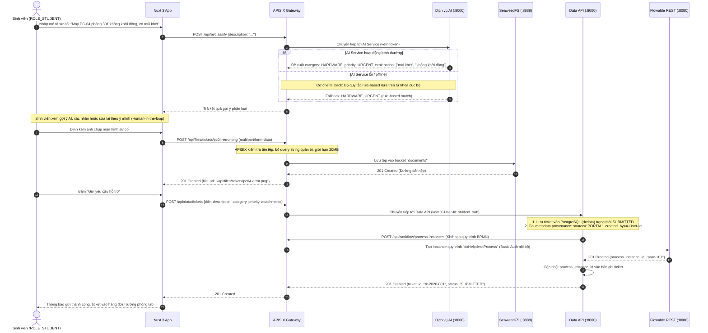
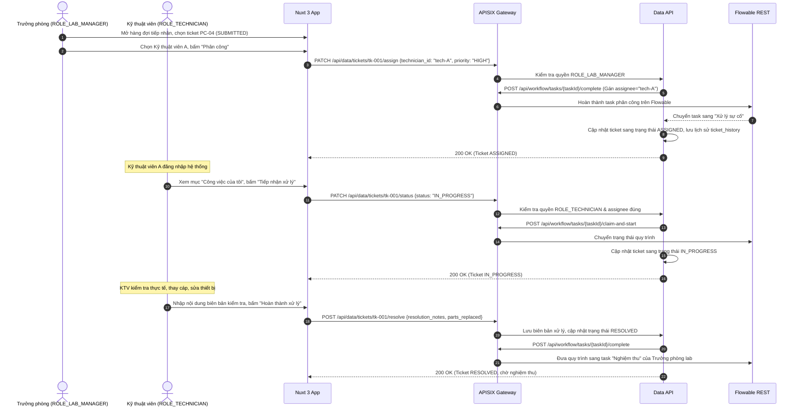
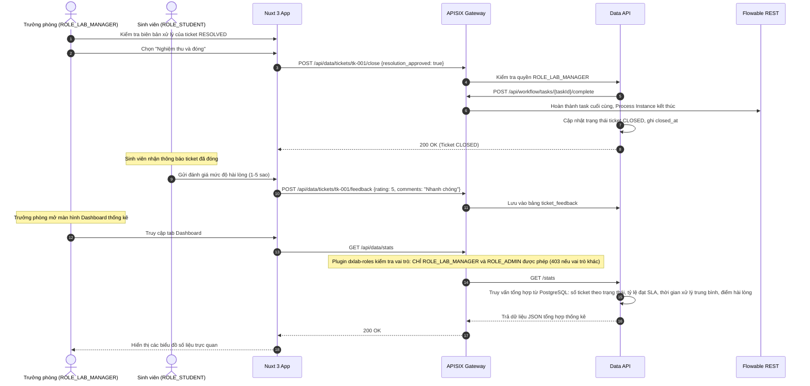
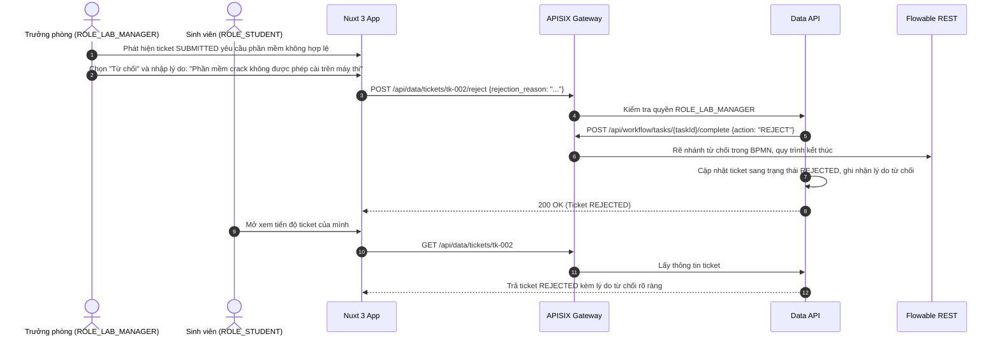

<!--
SPDX-FileCopyrightText: 2026 HaUI-Libre DX-Lab contributors
SPDX-License-Identifier: Apache-2.0
-->

# Kiến trúc Hệ thống DX-Lab & Luồng Gọi Dịch vụ

Tài liệu này mô tả kiến trúc tổng thể 3 tầng, không gian năng lực số **H-P-D-I**, sơ đồ ranh giới mạng và các luồng gọi dịch vụ của hệ thống **DX-Lab** – xây dựng trên nền tảng **DX-OS Open-Core** với ứng dụng minh họa **DX-Helpdesk** (tiếp nhận và xử lý yêu cầu hỗ trợ CNTT/phòng máy tại Trường Đại học Công nghiệp Hà Nội).

---

## 1. Kiến trúc tổng thể 3 tầng

Hệ thống được thiết kế theo mô hình 3 tầng rõ ràng nhằm phân tách trách nhiệm giữa nền tảng công nghệ lõi và ứng dụng nghiệp vụ cụ thể:




### Chi tiết các tầng

#### Tầng 3 – Ứng dụng nghiệp vụ (Business Application)
- **Sản phẩm minh họa:** **DX-Helpdesk** – tiếp nhận và xử lý yêu cầu hỗ trợ CNTT, thiết bị phòng máy thực hành tại HaUI.
- **Công nghệ:** Nuxt 3 (Vue 3, TypeScript).
- **Nguyên tắc:** UI chạy hoàn toàn trên trình duyệt người dùng và **không kết nối trực tiếp** đến bất kỳ CSDL (PostgreSQL), Flowable, SeaweedFS hay dịch vụ AI nào. Mọi tương tác đều đi qua API Gateway với Bearer token được cấp bởi Keycloak.

#### Tầng 2 – Không gian năng lực số H-P-D-I (Digital Capability Space)
Tầng 2 hiện thực hóa 4 không gian năng lực chuyển đổi số theo định hướng VFOSSA:

| Không gian | Chức năng nghiệp vụ DX-Helpdesk | Thành phần thực thi | Dịch vụ lõi Tầng 1 sử dụng |
|---|---|---|---|
| **H (Human)** – Con người & Tổ chức | Đăng nhập SSO, phân quyền 4 vai trò, quản lý hồ sơ và nhóm phòng máy | Keycloak OIDC Client, Portal Nuxt | Keycloak (Identity/SSO) |
| **P (Process)** – Quy trình | Vòng đời yêu cầu 7 trạng thái, phân công, hàng đợi xử lý, lịch sử chuyển trạng thái | Quy trình BPMN 2.0, Flowable Client | Flowable REST Engine |
| **D (Data)** – Dữ liệu & Bằng chứng | Lưu trữ ticket, gắn metadata provenance (`source`, `created_by`, `created_at`, `updated_at`), API lọc/tìm kiếm, API thống kê Dashboard | Data API (FastAPI) | PostgreSQL (Database `dxdata`) |
| **I (Intelligence)** – Trí tuệ hỗ trợ | Gợi ý loại sự cố và mức ưu tiên có giải thích; hỏi-đáp tài liệu hướng dẫn; Fallback rule-based | Dịch vụ AI (FastAPI, scikit-learn, Ollama) | pgvector (CSDL vector), SeaweedFS |

#### Tầng 1 – DX-OS Open-Core (Headless Platform)
- Đóng vai trò là nền tảng PaaS mở, **hoàn toàn headless** (không chứa UI người dùng cuối).
- Cung cấp các dịch vụ hạ tầng chuẩn hóa, độc lập với ứng dụng nghiệp vụ:
  1. **Apache APISIX (3.19.0):** API Gateway duy nhất quản lý toàn bộ lưu lượng API của hệ thống.
  2. **Keycloak (26.8.0):** Máy chủ xác thực danh tính và phân quyền tập trung (IdP/SSO).
  3. **PostgreSQL (18.6):** Hệ quản trị CSDL quan hệ chính với 3 database cách ly (`keycloak`, `flowable`, `dxdata`).
  4. **Flowable REST (7.2.0):** Động cơ thực thi quy trình nghiệp vụ BPMN 2.0 ở chế độ headless.
  5. **SeaweedFS (4.48):** Kho lưu trữ tệp đối tượng và tài liệu phi cấu trúc (ảnh chụp màn hình sự cố, biên bản kiểm tra).

---

## 2. Ranh giới mạng và cổng giao tiếp (Network & Port Topology)

Nhằm đảm bảo an toàn thông tin và cô lập tài nguyên, hệ thống thiết lập ranh giới mạng nghiêm ngặt thông qua Docker Compose:

```
┌────────────────────────────────────────────────────────────────────────┐
│ MÁY CHỦ HOST / MÔI TRƯỜNG PHÁT TRIỂN / TRÌNH DUYỆT NGƯỜI DÙNG           │
│                                                                        │
│   Trình duyệt / Client                   psql CLI (quản trị nội bộ)    │
│        │                 │                           │                 │
│        │ :9080           │ :8080                     │ :5432           │
│        ▼                 ▼                           ▼ (127.0.0.1)     │
├────────┼─────────────────┼───────────────────────────┼─────────────────┤
│ MẠNG DOCKER INTERNAL (dxlab bridge network)          │                 │
│        │                 │                           │                 │
│   ┌────▼────────┐   ┌────▼────────┐             ┌────▼────────┐        │
│   │   apisix    │   │  keycloak   │────────────►│  postgres   │        │
│   │   (:9080)   │   │   (:8080)   │             │   (:5432)   │        │
│   └──────┬──────┘   └─────────────┘             └────▲──▲─────┘        │
│          │                                           │  │              │
│          ├───────────────────────┐                   │  │              │
│          ▼                       ▼                   │  │              │
│   ┌─────────────┐         ┌─────────────┐            │  │              │
│   │  flowable   │─────────┼─────────────┼────────────┘  │              │
│   │   (:8080)   │         │  data-api   │───────────────┘              │
│   │ [KHÔNG MỞ   │         │   (:8000)   │                              │
│   │ CỔNG HOST]  │         │ [KHÔNG MỞ]  │                              │
│   └─────────────┘         └─────────────┘                              │
│          │                       │                                     │
│          ▼                       ▼                                     │
│   ┌─────────────┐         ┌─────────────┐                              │
│   │  seaweedfs  │         │     ai      │                              │
│   │   (:8888)   │         │   (:8000)   │                              │
│   │ [KHÔNG MỞ   │         │ [KHÔNG MỞ]  │                              │
│   │ CỔNG HOST]  │         │             │                              │
│   └─────────────┘         └─────────────┘                              │
└────────────────────────────────────────────────────────────────────────┘
```

### Phân định cổng mạng
- **Cổng công khai ra ngoài Host:**
  - `9080/tcp` (`apisix`): Cổng tiếp nhận toàn bộ request API từ UI Nuxt và bên ngoài.
  - `8080/tcp` (`keycloak`): Cổng tiếp nhận đăng nhập OIDC trên trình duyệt và bảng quản trị Keycloak Admin.
  - `5432/tcp` (`postgres`): **Chỉ bind trên `127.0.0.1`**, chỉ phục vụ lập trình viên chạy lệnh `make psql` trên máy cục bộ; không mở ra mạng ngoài.
- **Dịch vụ đóng kín hoàn toàn trong mạng nội bộ (Internal Only):**
  - `flowable` (cổng nội bộ 8080): Không mở cổng ra host; chỉ APISIX truy cập được sau khi xác thực token Bearer.
  - `seaweedfs` (cổng nội bộ 8888, 9333): Không mở cổng ra host; chỉ APISIX proxy qua route `/api/files/*`.
  - `data-api` (cổng nội bộ 8000): Chỉ APISIX proxy qua route `/api/data/*`.
  - `ai` (cổng nội bộ 8000): Chỉ APISIX proxy qua route `/api/ai/*`.

---

## 3. Các luồng gọi dịch vụ (Service Call Sequence Flows)


### 3.1. Luồng 1: Xác thực SSO và Phân quyền API Gateway

Mọi lời gọi API từ tầng trên đều phải đi kèm Bearer token JWT hợp lệ từ Keycloak. Gateway chịu trách nhiệm xác thực và kiểm tra vai trò:



### 3.2. Luồng 2: Sinh viên tạo yêu cầu hỗ trợ (Kèm ảnh & Gợi ý AI)

Minh họa kịch bản Sinh viên gửi yêu cầu hỗ trợ phòng máy (Kịch bản 1 & 6 trong đặc tả nghiệp vụ):



### 3.3. Luồng 3: Phân công kỹ thuật viên và Xử lý sự cố

Minh họa kịch bản Trưởng phòng lab phân công và Kỹ thuật viên xử lý (Kịch bản 2 & 3 trong đặc tả nghiệp vụ):



### 3.4. Luồng 4: Nghiệm thu, Đóng ticket và Tổng hợp Dashboard

Minh họa kịch bản Nghiệm thu và Cập nhật Dashboard (Kịch bản 4 trong đặc tả nghiệp vụ):



### 3.5. Luồng 5: Nhánh từ chối yêu cầu không hợp lệ

Minh họa kịch bản Từ chối ticket vi phạm nội quy phòng lab (Kịch bản 5 trong đặc tả nghiệp vụ):



---

## 4. Hợp đồng API Gateway và Phân quyền RBAC

Toàn bộ các tuyến đường API được định cấu hình tập trung trong `core/gateway/apisix.yaml`. Bảng phân quyền chi tiết theo ma trận RBAC:

| Tuyến đường Gateway | Phương thức | Vai trò được phép (RBAC) | Upstream nội bộ | Mô tả nghiệp vụ |
|---|---|---|---|---|
| `/api/me` | `GET, OPTIONS` | `ROLE_STUDENT`, `ROLE_TECHNICIAN`, `ROLE_LAB_MANAGER`, `ROLE_ADMIN` | Tự sinh từ Token | Lấy thông tin tài khoản hiện tại từ claims JWT |
| `/api/data/stats*` | `GET, OPTIONS` | `ROLE_LAB_MANAGER`, `ROLE_ADMIN` | `data-api:8000` | Số liệu thống kê Dashboard, đo lường SLA |
| `/api/data/*` | `ALL` | `ROLE_STUDENT`, `ROLE_TECHNICIAN`, `ROLE_LAB_MANAGER`, `ROLE_ADMIN` | `data-api:8000` | Quản lý vòng đời ticket, lịch sử provenance, phản hồi |
| `/api/workflow/repository/process-definitions` | `GET, OPTIONS` | `ROLE_STUDENT`, `ROLE_TECHNICIAN`, `ROLE_LAB_MANAGER`, `ROLE_ADMIN` | `flowable:8080` | Liệt kê các định nghĩa quy trình BPMN đã nạp |
| `/api/workflow/*` | `ALL` | Đã xác thực token | `flowable:8080` | Điều phối instance, hoàn thành task BPMN (qua APISIX) |
| `/api/files/*` | `GET, POST, PUT` | `ROLE_STUDENT`, `ROLE_TECHNICIAN`, `ROLE_LAB_MANAGER`, `ROLE_ADMIN` | `seaweedfs:8888` | Tải lên và tải về tệp ảnh đính kèm (giới hạn 20MB, CSP sandbox, không DELETE/list) |
| `/api/ai/*` | `POST, OPTIONS` | `ROLE_STUDENT`, `ROLE_TECHNICIAN`, `ROLE_LAB_MANAGER`, `ROLE_ADMIN` | `ai:8000` | Gợi ý phân loại sự cố, mức ưu tiên, hỏi đáp RAG |

---

## 5. Trạng thái thực tế triển khai so với Lộ trình (Reality vs Roadmap)

Để tuân thủ nguyên tắc minh bạch trong phát triển, dưới đây là bảng phân định giữa **các thành phần đã hoạt động thực tế** trong mã nguồn hiện tại và **các thành phần đang được triển khai theo kế hoạch**:

| Tầng / Thành phần | Công nghệ | Trạng thái hiện tại (M1) | Kế hoạch tiếp theo |
|---|---|---|---|
| **Tầng 1: PostgreSQL** | PostgreSQL 18.6 | **Đã chạy thực tế:** Service chạy trong Docker Compose, tự động tạo 3 CSDL riêng (`keycloak`, `flowable`, `dxdata`), có healthcheck. | Bổ sung pgvector ở M3. |
| **Tầng 1: Keycloak** | Keycloak 26.8 | **Đã chạy thực tế:** Tự import realm `dxlab`, client `dxlab-app`, 4 roles, 4 tài khoản demo (`sinhvien`, `kythuatvien`, `truongphong`, `quantri`). | Tích hợp cổng đăng nhập Nuxt ở M2. |
| **Tầng 1: APISIX Gateway** | Apache APISIX 3.19 | **Đã chạy thực tế:** Chạy standalone, xác thực Bearer token qua JWKS, plugin `dxlab-roles` kiểm tra RBAC; `make smoke` kiểm tra tự động 401/200/403. | Bổ sung rate-limiting nếu cần. |
| **Tầng 1: Flowable REST** | Flowable REST 7.2 | **Đã chạy thực tế:** Kết nối database `flowable` trên PostgreSQL, route `/api/workflow/...` qua gateway dùng Basic Auth nội bộ an toàn. | Nạp file BPMN `dxHelpdeskProcess.bpmn20.xml` ở M2 (#18, #19). |
| **Tầng 1: SeaweedFS** | SeaweedFS 4.48 | **Đã cấu hình & chạy:** Master/Volume/Filer, bucket `documents`, route `/api/files/*` có kiểm tra bảo mật (chặn quản trị, CSP sandbox, max 20MB). | Tích hợp tải ảnh từ UI ở M2. |
| **Tầng 2: Data API** | FastAPI | **Đã có hợp đồng:** Schema CSDL `data/schema.sql` và đặc tả `data/openapi.yaml` đã thiết kế ở #16. | Triển khai mã nguồn FastAPI, CRUD ticket, provenance ở M2 (#20, #21, #22). |
| **Tầng 2: Dịch vụ AI** | FastAPI / scikit-learn / Ollama | **Đặc tả nghiệp vụ đã chốt:** Định nghĩa các categories, priorities và kịch bản fallback rule-based ở docs/usecases.md. | Huấn luyện mô hình, đóng gói Compose, xây dựng RAG ở M3 (#28 - #31). |
| **Tầng 3: Giao diện người dùng** | Nuxt 3 | **Đã có cấu trúc thư mục:** Thư mục `app/` đã được phân công trong bộ khung dự án. | Dựng giao diện H-P-D-I và kịch bản DX-Helpdesk ở M2 (#24 - #27). |

---

## 6. Các quyết định kiến trúc then chốt (ADR - Architecture Decision Records)

### ADR-01: Kiến trúc 3 tầng với Tầng 1 Open-Core hoàn toàn Headless
- **Bối cảnh:** Đề thi PMNM HaUI 2026 đặt trọng tâm vào việc xây dựng Hệ điều hành Chuyển đổi số (DX-OS Open-Core) bằng công nghệ lõi nguồn mở.
- **Quyết định:** Tầng 1 là Open-Core headless (Keycloak, APISIX, PostgreSQL, SeaweedFS, Flowable) không chứa bất kỳ giao diện người dùng cuối nào. Mọi giao diện nằm ở Tầng 2/3.
- **Lý do:** Tách biệt triệt để tầng nền tảng và tầng ứng dụng. Khi cần thay đổi hoặc bổ sung một ứng dụng nghiệp vụ mới (ví dụ Quản lý phòng máy, Mượn trả thiết bị, Điểm danh số), nhóm phát triển chỉ cần xây dựng ứng dụng Tầng 3 và gọi lại các dịch vụ lõi Tầng 1 mà không phải sửa đổi nền tảng Open-Core.

### ADR-02: Cửa ngõ duy nhất API Gateway (APISIX Standalone) & Xác thực OIDC JWKS (Keycloak)
- **Bối cảnh:** Hệ thống gồm nhiều dịch vụ nội bộ (Data API, Flowable REST, SeaweedFS, AI). Cần đảm bảo an toàn, tránh để client truy cập trực tiếp các service nội bộ và tối ưu hóa hiệu năng kiểm tra token.
- **Quyết định:**
  1. Chỉ mở cổng Gateway 9080 ra ngoài. Mọi lời gọi từ UI đều phải đi qua APISIX.
  2. APISIX chạy chế độ `standalone` (đọc route từ `core/gateway/apisix.yaml`), không phụ thuộc etcd hay Admin API, giúp giảm thiểu tài nguyên tiêu thụ.
  3. Sử dụng plugin `openid-connect` với `use_jwks: true` và `bearer_only: true`: Gateway tải JWKS công khai từ Keycloak một lần và xác thực chữ ký số cục bộ, không gửi yêu cầu introspect qua mạng cho mỗi request, giúp độ trễ đạt mức tối thiểu.
  4. Viết plugin tùy biến `dxlab-roles.lua` để kiểm tra phân quyền RBAC và trả mã lỗi `403 Forbidden` chuẩn xác khi không đủ vai trò, đồng thời chèn các header định danh `X-User-Id`, `X-User-Name`, `X-User-Roles` xuống các upstream.

### ADR-03: Tách bạch Quản lý trạng thái Quy trình (Flowable) và Dữ liệu nghiệp vụ (Data API / PostgreSQL)
- **Bối cảnh:** Yêu cầu hỗ trợ phòng máy vừa có thuộc tính nghiệp vụ tĩnh (mô tả, danh mục, phòng máy, thiết bị, metadata provenance) vừa có sự biến đổi trạng thái động theo luồng công việc (BPMN).
- **Quyết định:** Flowable chỉ quản lý tiến trình nghiệp vụ (Process Instance, User Task, lịch sử chuyển bước). Data API lưu trữ dữ liệu nghiệp vụ của ticket trong bảng `tickets`. Hai hệ thống liên kết với nhau qua khóa ngoại tham chiếu `process_instance_id`.
- **Lý do:** Phân định ranh giới trách nhiệm rõ ràng (Separation of Concerns). Flowable tối ưu cho việc điều phối luồng quy trình phức tạp; PostgreSQL và Data API tối ưu cho việc tìm kiếm, lọc, thống kê và lưu trữ bằng chứng kiểm toán (provenance) lâu dài.

### ADR-04: Lưu trữ tệp tách biệt qua SeaweedFS Headless kết hợp kiểm soát bảo mật
- **Bối cảnh:** Sự cố phòng lab thường đính kèm ảnh chụp màn hình xanh, ảnh cháy hỏng linh kiện hoặc biên bản bàn giao dạng PDF. Nếu lưu trực tiếp dạng BLOB trong CSDL quan hệ sẽ làm phình to dung lượng và giảm hiệu năng truy vấn.
- **Quyết định:** Sử dụng SeaweedFS (Filer) làm kho lưu trữ đối tượng phi cấu trúc. Người dùng tải tệp qua route `/api/files/*` của Gateway. CSDL chỉ lưu đường dẫn tệp. Gateway áp dụng giới hạn 20MB, lọc query string quản trị nguy hiểm, chỉ cho phép phương thức `GET/POST/PUT`, và thêm các header `X-Content-Type-Options: nosniff`, `Content-Security-Policy: sandbox` khi tải về.
- **Lý do:** Đảm bảo hiệu năng CSDL, chống tấn công ghi đè/xóa trái phép hoặc thực thi mã độc qua tệp SVG/HTML người dùng tải lên.

### ADR-05: AI hỗ trợ có kiểm soát (Human-in-the-loop) và Fallback Rule-based
- **Bối cảnh:** Dịch vụ AI (LLM / bộ phân loại) có thể gặp sự cố quá tải, mất kết nối hoặc trả về kết quả dự đoán sai lệch.
- **Quyết định:**
  1. Gợi ý từ AI chỉ mang tính chất tham khảo có giải thích (Explainable AI); người dùng luôn là người ra quyết định cuối cùng trước khi bấm gửi yêu cầu.
  2. Tuyệt đối không để AI tự động chuyển trạng thái quy trình hoặc tự quyết định mức ưu tiên cuối cùng.
  3. Hệ thống luôn tích hợp sẵn bộ quy tắc suy diễn dự phòng (Rule-based Fallback) dựa trên từ khóa sự cố khi dịch vụ AI ngoại tuyến.
- **Lý do:** Đảm bảo hệ thống Helpdesk luôn sẵn sàng hoạt động 24/7 (High Availability), không bị gián đoạn quy trình nghiệp vụ khi hạ tầng AI gặp sự cố.
